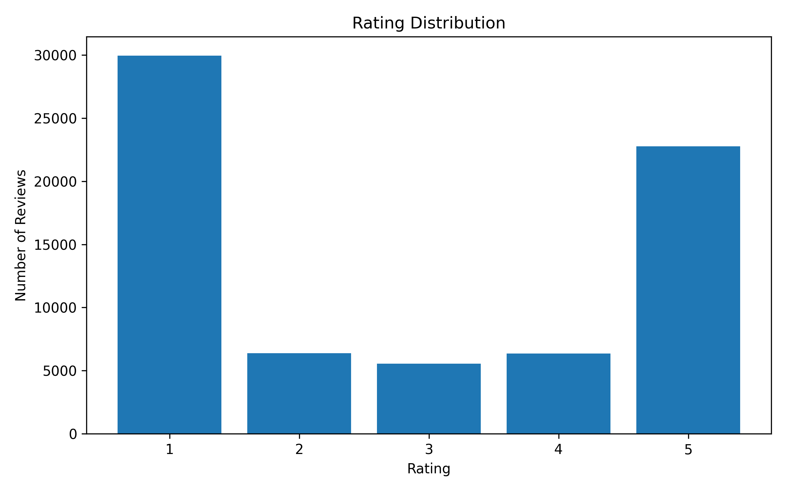
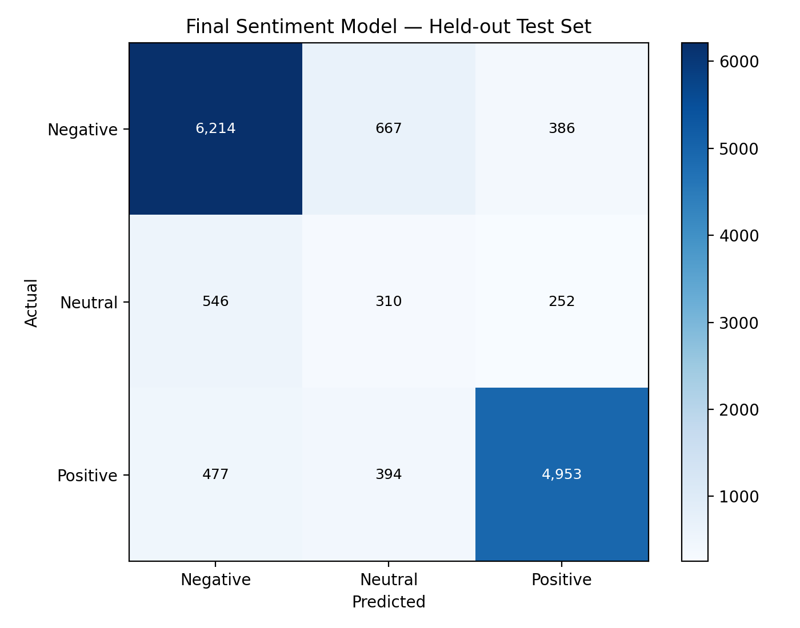
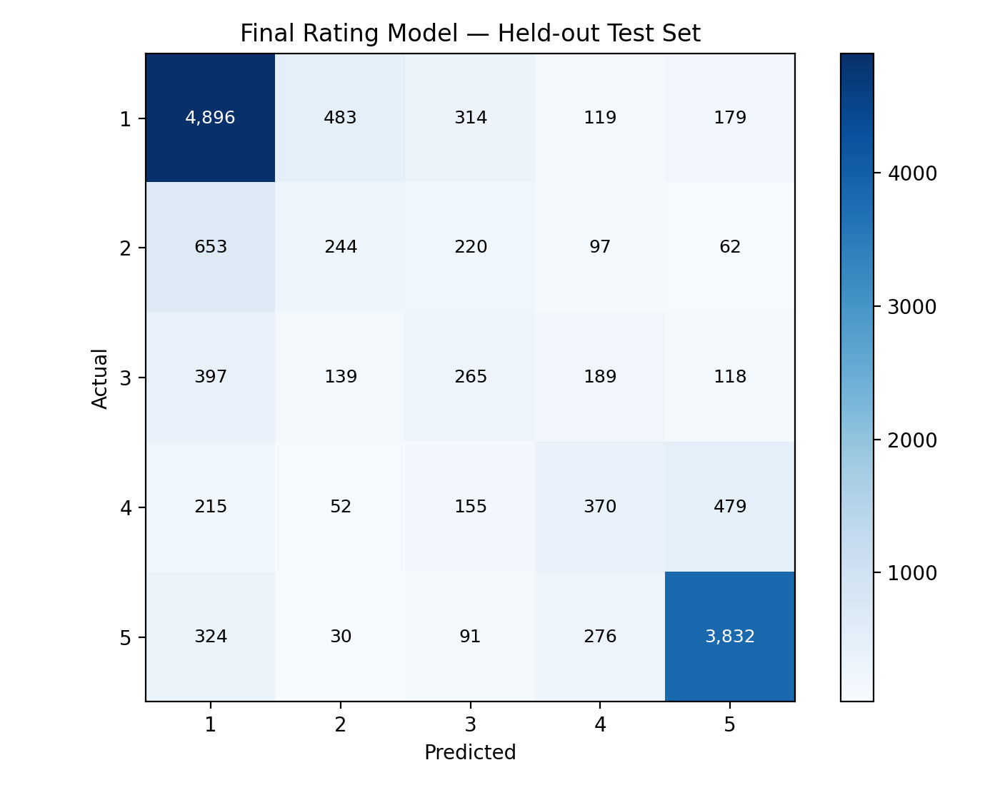
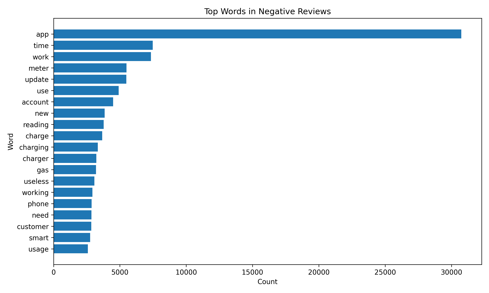
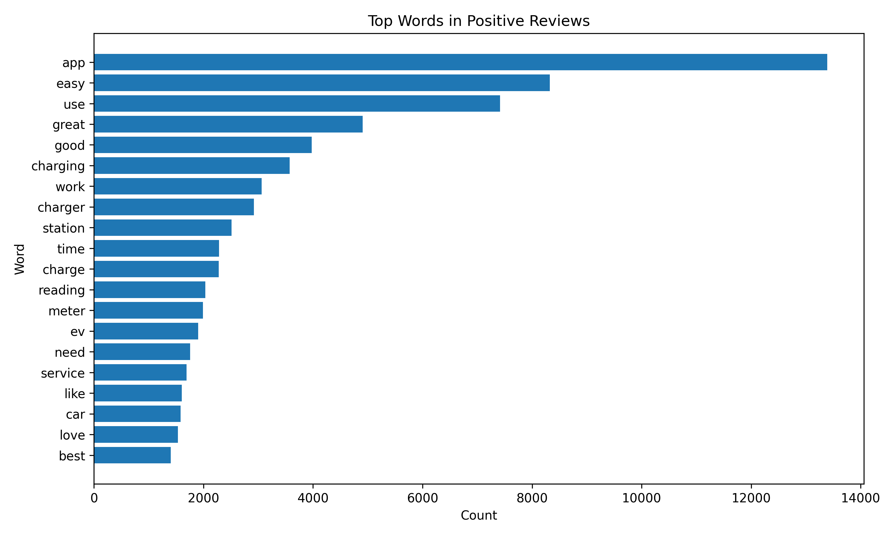

# Energy App Review Sentiment Analysis and Rating Prediction

**Not every useful signal in energy services comes from a sensor.** App reviews offer another view: what customers encounter while managing accounts, paying bills, or charging an EV.

I built this Python NLP project to work with that feedback. It collects public app-store reviews, prepares English-language text for machine learning, explores common terms, and trains models to predict sentiment and star ratings. The repository includes the collection and preprocessing code, experiment notebooks, evaluation reports, and a small command-line prediction demo.

## What the project predicts

- **Sentiment classification:** Negative, Neutral, or Positive.
- **Star-rating prediction:** The original rating, from 1 to 5.

The sentiment classes are **derived from the reviewer's star rating**, not separately annotated: 1–2 stars = Negative, 3 stars = Neutral, and 4–5 stars = Positive. The tasks therefore measure how reliably text predicts rating-derived labels and ratings, not agreement with a human sentiment survey.

## Dataset

Reviews come from **Google Play and Apple's App Store**, across relevant country storefronts. Only reviews passing the English-language and text-quality checks were retained, regardless of storefront country.

| Measure | Value |
| --- | ---: |
| Collected, English-filtered reviews | 71,067 |
| Final preprocessed reviews | 70,994 |
| Applications | 19 |
| Google Play reviews (raw) | 60,839 |
| Apple App Store reviews (raw) | 10,228 |
| Average preprocessed rating | 2.80 / 5 |
| Average review length | 29.26 words |
| Negative reviews | 36,334 |
| Neutral reviews | 5,539 |
| Positive reviews | 29,121 |

The applications cover energy suppliers, EV charging networks, mobility services, and smart-home energy products. The full **19-app** catalog, including platform IDs, is in [`config/energy_apps_shortlist.csv`](config/energy_apps_shortlist.csv). Selected examples include PlugShare, ChargePoint, Octopus Energy, ScottishPower, Hive, and EDF.

### How the reviews were prepared

The collector retrieves written reviews and metadata, deduplicates review IDs across storefronts, and applies a minimum length and English-language confidence threshold. The preprocessing pipeline then cleans and normalizes the review text, removes unusable entries, and preserves negations that can change meaning (such as *not working*).

The raw dataset contains 71,067 accepted English-language records. During preprocessing, **72 reviews** were excluded from ambiguous same-app text groups that had different ratings, and **one** further record was excluded because its cleaned text was empty. This leaves **70,994** modeling records.

No user-generated review text or trained `.pkl` model is committed to the repository. Public store availability can change, so a fresh collection is not guaranteed to reproduce exactly the same data volume.

### Rating distribution



Reviews concentrate at 1 and 5 stars. That imbalance is one reason we look at **Macro F1**, not just accuracy, particularly for neutral sentiment and middle ratings.

## Modeling approach

For a fair comparison, both prediction tasks use the **same train / validation / test split**. `StratifiedGroupKFold` groups identical normalized cleaned text so identical text cannot occur on both sides of a split. Model selection uses **validation Macro F1**; the selected model is refitted on training plus validation data and then scored on the untouched test set.

| Partition | Reviews |
| --- | ---: |
| Training | 42,596 |
| Validation | 14,199 |
| Held-out test | 14,199 |

Candidates include word-count features, word-level TF-IDF, character-level TF-IDF, Multinomial Naive Bayes, Logistic Regression, and LinearSVC. The experiments and evaluation logic are in [`src/train.py`](src/train.py); Notebook 03 explains and verifies the saved results.

## Validation-set model comparisons

These scores were used to select the models. **They are not test-set results.**

### Sentiment candidates

| Stage | Model | Accuracy | Macro F1 | Weighted F1 |
| --- | --- | --- | --- | --- |
| Baseline | CountVectorizer + Naive Bayes | 0.8067 | 0.6645 | 0.8104 |
| Candidate | CountVectorizer + Tuned Naive Bayes | 0.8062 | 0.6644 | 0.8103 |
| Candidate | Character TF-IDF + Logistic Regression | 0.7546 | 0.6522 | 0.7877 |
| Selected | TF-IDF + LinearSVC | 0.8176 | 0.6672 | 0.8200 |

### Rating candidates

| Stage | Model | Accuracy | Macro F1 | Weighted F1 | MAE |
| --- | --- | --- | --- | --- | --- |
| Selected | CountVectorizer + Naive Bayes | 0.6729 | 0.4737 | 0.6615 | 0.5680 |
| Candidate | CountVectorizer + Logistic Regression | 0.5915 | 0.4552 | 0.6225 | 0.6360 |
| Candidate | TF-IDF + LinearSVC | 0.6534 | 0.4713 | 0.6562 | 0.5693 |
| Candidate | Character TF-IDF + Logistic Regression | 0.5974 | 0.4700 | 0.6314 | 0.6121 |

## Final results — held-out test set

| Task | Selected model | Accuracy | Macro F1 | Weighted F1 | MAE (stars) |
| --- | --- | --- | --- | --- | --- |
| sentiment | TF-IDF + LinearSVC | 0.8083 | 0.6583 | 0.8140 | — |
| rating | CountVectorizer + Naive Bayes | 0.6766 | 0.4800 | 0.6651 | 0.5650 |

The selected sentiment model is **TF-IDF + LinearSVC**. Its test-set accuracy is **80.83%**, with a Macro F1 of **0.6583**.

The selected rating model is **CountVectorizer + Naive Bayes**. It achieved **67.66%** exact-rating accuracy and **0.565 stars** in mean absolute error. **85.9%** of test predictions were within one star of the original rating.

An accuracy figure alone would miss some of the difficulty with the smaller middle-rating classes. MAE is helpful for the ordered rating task: a prediction of 4 instead of 5 is a smaller error than a prediction of 1 instead of 5.

### Where the models struggle





The models generally find more clear-cut positive and negative language easier than mixed reviews. This is a practical limitation of text-based rating estimation, not something the aggregate accuracy resolves.

## Review language and customer feedback





Word-frequency patterns can provide a quick starting point for exploring recurring topics such as charging, updates, logins, and payments. They are **descriptive signals**, not a verified root-cause analysis or a separate issue-detection classifier.

## Run locally

Use Python 3.10+ and the dependencies in `requirements.txt`. On Windows PowerShell:

```powershell
git clone https://github.com/jay050699/energy-app-review-sentiment-rating-prediction.git
cd energy-app-review-sentiment-rating-prediction
python -m venv .venv
.venv\Scripts\Activate.ps1
python -m pip install -r requirements.txt
```

The pipeline can be run from the repository root:

```powershell
python src/collect_reviews.py
python src/preprocessing.py
python src/train.py
python src/predict.py
python src/predict.py --text "The app keeps crashing and I cannot submit my meter reading."
```

The review collector can take considerable time; it uses cached collection results where available, and accessible review counts may vary by store and date. The notebooks are ordered `01_data_exploration.ipynb` → `02_text_preprocessing.ipynb` → `03_model_training_evaluation.ipynb`. Notebook 03 inspects saved models; it does not retrain them.

## Repository contents

| Path | Purpose |
| --- | --- |
| `config/` | Energy-app list and platform IDs |
| `data/` | Local raw and preprocessed data placeholders; datasets excluded from Git |
| `docs/` | Dataset notes and project plan |
| `notebooks/` | Data exploration, feature extraction, evaluation |
| `reports/` | CSV summaries, confusion matrices, charts, and Excel summary |
| `models/` | Locally generated fitted models, excluded from Git |
| `src/` | Reusable collection, preprocessing, training, and prediction code |
| `requirements.txt` | Python dependencies |

The summary workbook is available in [`reports/excel/energy_app_review_project_summary.xlsx`](reports/excel/energy_app_review_project_summary.xlsx).

## Limitations and next steps

- Reviews are self-selected, not a representative sample of all customers.
- Sentiment labels are derived from star ratings, not independently labeled by people.
- Normalized-text grouping prevents exact duplicate leakage, but not every near-duplicate or paraphrase.
- Some comments describe the broader service experience rather than just app behavior.
- Store review availability and language-detection accuracy may change over time.
- Future extensions could include stronger neutral/middle-class coverage, ordinal rating models, multilingual analysis, and evaluation on held-out applications or more recent reviews.

This is an independent demonstration project using publicly available app reviews, not an official company dataset or deployed service.
